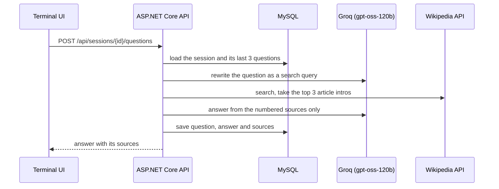

# RetroScan.AI

A research terminal that answers questions from Wikipedia, cites every claim, and keeps your research sessions in MySQL. Built with ASP.NET Core Web API, EF Core and xUnit.

## What it does

- You type a question into a retro CRT terminal in the browser.
- The API turns it into a Wikipedia search query, using your earlier questions to resolve words like "it" or "they".
- It fetches the top three matching articles and asks a language model on Groq to answer **only from those articles**, citing them as `[1]`, `[2]`. When the search finds nothing, the API says so instead of asking the model for an answer.
- Every question, answer and source is stored in MySQL, grouped into sessions you can reopen or delete.
- There are no accounts. Each browser gets an anonymous owner cookie and every query is scoped to it, so a visitor only ever sees their own sessions.

## How a question is answered



## Stack

| Area | Used |
| --- | --- |
| API | C# on .NET 10, ASP.NET Core Web API with controllers, ProblemDetails errors, built-in rate limiting, health checks, Swagger |
| Data | MySQL 8.4, EF Core 10 with Oracle's `MySql.EntityFrameworkCore` provider, code-first migrations |
| Integrations | Typed `HttpClient`s for Groq's OpenAI-compatible chat API and the MediaWiki API, no SDKs |
| Tests | xUnit: unit tests with stubbed HTTP, integration tests through `WebApplicationFactory` against a real MySQL in Testcontainers |
| Front end | Plain HTML, CSS and JavaScript, served by the API |
| Delivery | Dockerfile, docker compose, GitHub Actions |

## API

| Method | Route | Result |
| --- | --- | --- |
| `GET` | `/api/sessions` | Your sessions, most recently used first |
| `POST` | `/api/sessions` | `201` with the new session (title optional) |
| `GET` | `/api/sessions/{id}` | The session with its questions and sources, or `404` |
| `DELETE` | `/api/sessions/{id}` | `204`; MySQL cascades the delete to questions and sources |
| `POST` | `/api/sessions/{id}/questions` | `200` with the answer; `400` invalid, `404`, `429` rate limited, `502` Groq or Wikipedia failed, `503` no API key |
| `GET` | `/health` | Database health check |

Swagger UI is at `/swagger`. Errors use RFC 9457 ProblemDetails.

## Run it locally

You need Docker and a free API key from [console.groq.com](https://console.groq.com/keys).

**Everything in Docker.** Put the key in a `.env` file next to `docker-compose.yml` (it is gitignored):

```
GROQ_API_KEY=your-key
```

```
docker compose --profile app up --build
```

Open http://localhost:8080. If that port is taken, set `RETROSCAN_PORT=8090` in `.env`.

**From source**, with the .NET 10 SDK:

```
docker compose up -d mysql
dotnet user-secrets set "Groq:ApiKey" "your-key" --project src/RetroScan.Api
dotnet run --project src/RetroScan.Api
```

Open http://localhost:5080. Migrations run on startup. Without a key the app still runs, and asking a question returns `503`.

## Tests

```
dotnet test
```

The integration tests need Docker running: Testcontainers starts a throwaway `mysql:8.4` for them. They cover the full HTTP flow, sessions staying private to their owner, cascade deletes, validation, the rate limit, and upstream failures returning `502`/`503` with nothing stored. Unit tests check the exact requests sent to Groq and Wikipedia and how the prompts are built.

## Configuration

| Key | Default | Notes |
| --- | --- | --- |
| `ConnectionStrings:RetroScan` | local compose MySQL in Development | |
| `Groq:ApiKey` | none | user secrets locally, an environment variable in production |
| `Groq:Model` | `openai/gpt-oss-120b` | any Groq chat model |
| `Groq:ReasoningEffort` | `low` | leave empty for models without reasoning |
| `RateLimit:PermitLimit`, `RateLimit:Window` | 4 per `00:01:00` | per client IP, on asking only |
| `Database:MigrateOnStartup` | `true` | |
| `ASPNETCORE_FORWARDEDHEADERS_ENABLED` | unset | set to `true` behind a reverse proxy, so the rate limit sees client IPs |

As environment variables, use double underscores: `Groq__ApiKey`.

## Project layout

```
src/RetroScan.Api
  Controllers/     SessionsController
  Research/        SessionService, ResearchService, prompts
  LanguageModel/   Groq client behind ILanguageModel
  Sources/         Wikipedia client behind ISourceSearch
  Data/            DbContext, entities, migrations
  Owners/          anonymous owner cookie
  Errors/          upstream failures as ProblemDetails
  wwwroot/         terminal UI
tests/RetroScan.Api.Tests
  Api/             integration tests against MySQL
  LanguageModel/, Sources/, Research/   unit tests
```

## Design notes

- **Grounded answers.** The model sees only the retrieved article intros and must cite them. Earlier answers go back into the conversation with their `[n]` markers stripped, because those numbers pointed at older source lists.
- **Privacy without accounts.** A session that belongs to someone else returns `404`, not `403`, so the API does not confirm that an id exists.
- **Cost control.** The public demo spends a free-tier Groq quota, so asking is rate limited per IP and the answer call is skipped when the search comes back empty.
- **Interfaces at the edges.** Groq and Wikipedia sit behind `ILanguageModel` and `ISourceSearch`, which is what lets the integration tests run the real API and database with fake external services.
